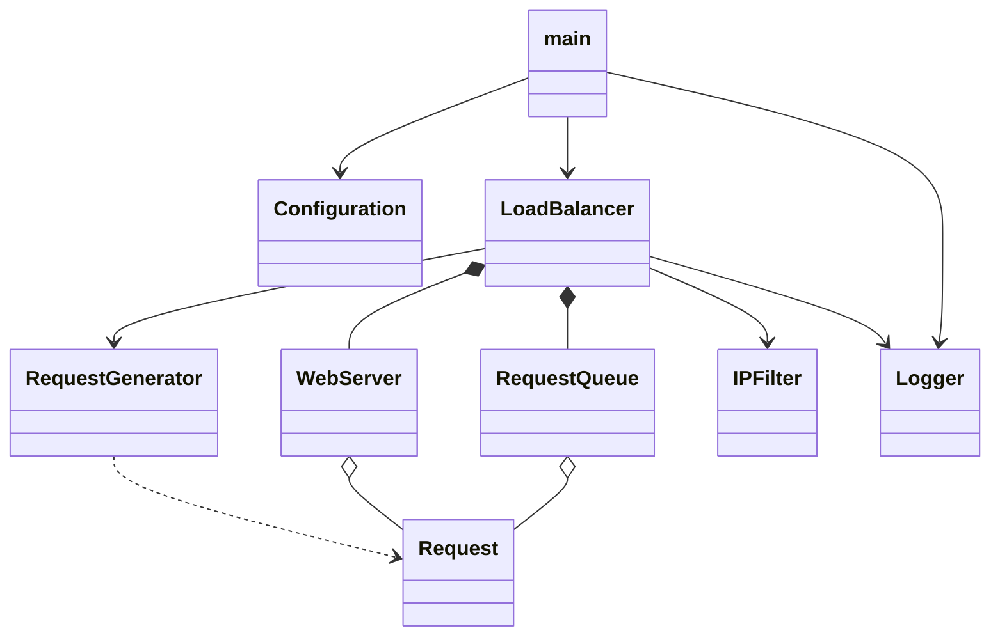

# Meridian Cloud Load Balancer — System Design

This document is the implementation contract for the mandatory C++ simulator. It completes Phase 1 of `project.md`. The design follows the Meridian Cloud identity used by the project website: navy, teal, and gold, with the tagline “Balanced traffic. Steady service.” The optional switch is intentionally outside the mandatory design.

## Goals and boundaries

The program simulates a single FIFO request queue, a dynamically sized pool of web servers, randomized request arrivals, an IPv4 range firewall, and event and summary logging. It does not open network connections. The required reference run is 20 initial servers and 100,000 cycles, with an initial queue of 2,000 requests, random arrivals, scaling and firewall enabled, and quiet logging.

## Components, ownership, and interfaces

`main` owns startup and shutdown orchestration. It loads and validates `Configuration`, constructs the `Logger`, `RequestGenerator`, `IPFilter`, and `LoadBalancer`, asks the balancer to run, and requests the final report. It does not implement scheduling or scaling.

| Component | Owned state | Public interface (proposed C++) | Responsibility |
|---|---|---|---|
| `Request` | `uint64_t id`, `string ipIn`, `string ipOut`, `int timeCycles`, `char jobType`, `uint64_t arrivalCycle` | Plain aggregate struct | Carries a request. `jobType` is `P` or `S`; `timeCycles` is positive. |
| `Configuration` | Initial server count, run length, queue multiplier, scaling thresholds and cooldown, arrival settings, duration limits, seed, log mode/path, blocked ranges, blocked-request test fraction | `static Configuration load(const string& path)`; `void validate() const` | Parses configuration and rejects invalid or inconsistent values before simulation starts. |
| `RequestGenerator` | `mt19937_64` engine, inclusive duration bounds, and next request ID | `RequestGenerator(uint64_t seed, int minDuration, int maxDuration)`; `Request make(uint64_t cycle)` | Makes valid addresses, inclusive duration range, and a `P`/`S` type. One engine is seeded once. The configured seed makes runs reproducible. |
| `IPFilter` | Parsed inclusive IPv4 ranges and blocked count | `explicit IPFilter(const vector<IPRange>&)`; `bool isBlocked(const string& ip) const`; `uint64_t blockedCount() const` | Parses addresses/ranges as 32-bit values and checks source addresses. Malformed addresses/ranges fail configuration loading. |
| `RequestQueue` | `queue<Request>` and peak size | `void push(const Request&)`; `Request pop()`; `bool empty() const`; `size_t size() const`; `size_t peakSize() const` | FIFO storage for accepted requests awaiting assignment. `pop` throws if the queue is empty. |
| `WebServer` | ID, optional active request, remaining cycles, completed count, busy cycles, active/retiring state | `explicit WebServer(size_t id)`; `bool isBusy() const`; `bool isIdle() const`; `bool assign(const Request&)`; `optional<Request> tick()`; `void retireWhenIdle()`; `bool isRetiring() const`; `ServerStats stats() const` | Processes at most one request at a time. Returns a completed request from `tick`; never accesses the shared queue. A retiring server accepts no new work and is removed once idle. |
| `LoadBalancer` | `LoadBalancerOptions`, queue, `vector<unique_ptr<WebServer>>`, retired-server stats, clock, generator, cooldown, and counters | `LoadBalancer(const LoadBalancerOptions&)`; `void addRequest(const Request&)`; `void assignRequests()`; `void checkScaling()`; `void step()`; `void run()`; `size_t getQueueSize() const`; `size_t getServerCount() const`; `LBStats getStatistics() const` | Owns server lifetime and queue; provides initial workload, FIFO assignment, service-cycle advancement, one-at-a-time autoscaling, and core statistics. Later phases add arrivals, filtering, configuration-file loading, and logging. |
| `Logger` | Mode, output stream/file, color setting | `Logger(LogMode, const string& path, bool color)`; `void event(EventLevel, const string&)`; `void startSummary(const Configuration&)`; `void finalSummary(const LBStats&)` | Writes the same meaningful event stream to the log file and, as configured, the console. Quiet mode writes only start and final summaries; verbose mode also writes significant events. |

`LoadBalancer` owns each `WebServer` through `unique_ptr`; it owns `RequestQueue` by value and coordinates `IPFilter`, `RequestGenerator`, and `Logger` through references or values with explicit lifetime. `WebServer` owns its active request by value/optional. `RequestQueue` owns waiting requests by value. No server mutates the queue. The logger does not own simulation state.

### Relationships



`LBStats` records generated, accepted, rejected, completed, queued-at-end, and in-flight-at-end requests; servers added/removed; peak and final server counts; queue peak and sum/average; scaling-limit/deferred-scale-down counters; and per-server completion and busy-cycle counts. “Generated” counts all created requests, “rejected” counts generated requests denied by the filter, and “accepted” counts requests placed in the queue. Therefore `generated = accepted + rejected` at every completed run. In-flight requests are reported separately from queued work and are not counted complete.

## Simulation contract

The clock begins at cycle 0. The initial queue is filled before cycle 1 with `initialServers * initialRequestsPerServer` generated requests stamped with arrival cycle 0; each is passed through the firewall. The configured queue multiplier defaults to 100. Initial rejected requests count as generated and rejected, not accepted.

The Phase 4 and 5 implementation provides the queue/server simulation and dynamic scaling: it creates the initial queue, advances existing server work, scales according to configured queue thresholds and cooldown, assigns waiting requests FIFO, and tracks core counts. It intentionally has no runtime arrivals, firewall, configuration-file parser, or logger yet; those are subsequent roadmap phases. Until filtering is integrated, `addRequest` means an already accepted request and increments both generated and accepted counts.

For each cycle `c` from 1 through `runCycles`, execute these steps in order:

1. Advance every request that was already processing at the start of the cycle by one cycle. A duration-5 request assigned after cycle 1's tick completes on cycle 6's tick: it receives exactly five ticks, beginning on the cycle after assignment. A request completing in this step makes its server idle.
2. Generate the configured random arrival event/batch for cycle `c`. For each generated request, increment generated, inspect its source IP, increment rejected and log a rejection if blocked, or stamp/enqueue it and increment accepted if allowed. The generator deliberately samples the configured blocked-request fraction from blocked ranges so firewall behavior can be observed in reproducible runs; set the fraction to zero to disable injected blocked traffic while retaining filtering.
3. Evaluate scaling at most once. Scaling uses the waiting queue and current server count. It is eligible when the cooldown has expired. If queue size is greater than `maxPerServer * serverCount`, add one server. Otherwise, if queue size is less than `minPerServer * serverCount` and more than the minimum server count exists, remove one idle server. High threshold is checked first; at most one action occurs per check. Comparisons are strict (`>` and `<`).
4. Assign requests FIFO to idle servers until either the queue is empty or no idle server remains. Newly assigned work does not receive a tick in the same cycle.
6. Record end-of-cycle queue size, server counts, and busy counts; update aggregate statistics; then advance the clock to `c`.

Cooldown is measured in cycles between successful server-count changes. Once a scale action occurs, no later scale action is permitted until `scalingCooldown` cycles have passed. An unsuccessful check (queue in range or a scaling limit reached) does not restart cooldown. Setting cooldown to zero allows a check each cycle, still limited to one action per cycle. Scale-down removes only an idle server; if every server is busy, the action is deferred and retried at the next eligible check. The pool never falls below `minServers` or grows above `maxServers`. At the configured final cycle, the simulation stops without draining. Remaining queued and in-flight requests are reported separately.

Random arrival settings define a per-cycle arrival probability and an inclusive batch-size range. A successful arrival event generates a batch; a failed event generates none. One seeded engine drives arrival decisions and request attributes in a documented fixed order, so identical configuration and seed reproduce the same run. IPv4 addresses are sampled across all four octets; firewall correctness is verified with deliberately constructed requests that fall inside and outside configured ranges, rather than relying on a random hit.

## Logging and configuration decisions

Configuration is validated before any servers or requests are created. Counts and durations must be positive where required; the minimum duration cannot exceed the maximum; probabilities and blocked-source fraction must be in `[0,1]`; lower scaling threshold must be below upper threshold; blocked ranges must be valid inclusive IPv4 ranges. The reference scenario uses quiet mode and a 20-server, 100,000-cycle run. Exact request-duration range and arrival settings used in a submitted log must be stated in that run's configuration and summary.

Quiet mode emits one startup configuration summary and one end summary to console and file. Verbose mode additionally records accepted/rejected requests, assignments, completions, and each server scale/retirement event; it does not print every idle cycle. Console colors are presentation only (teal/cyan headings, green scale-up, gold scale-down, red firewall rejection) and are disabled when output is not a terminal. The log file remains plain text.

## Implementation file map

```text
include/Request.h
include/RequestQueue.h          src/RequestQueue.cpp
include/Configuration.h       src/Configuration.cpp
include/RequestGenerator.h    src/RequestGenerator.cpp
include/RequestQueue.h
include/WebServer.h           src/WebServer.cpp
include/IPFilter.h            src/IPFilter.cpp
include/Logger.h              src/Logger.cpp
include/LoadBalancer.h        src/LoadBalancer.cpp
src/main.cpp
config/meridian.cfg
logs/.gitkeep
Makefile
Doxyfile
```

The interfaces above are the agreed design surface; implementation may adjust syntax to fit the C++ standard selected by the Makefile, while preserving ownership and behavior. Bonus routing, multiple balancers, and the switch are deferred until the mandatory simulator is complete.
