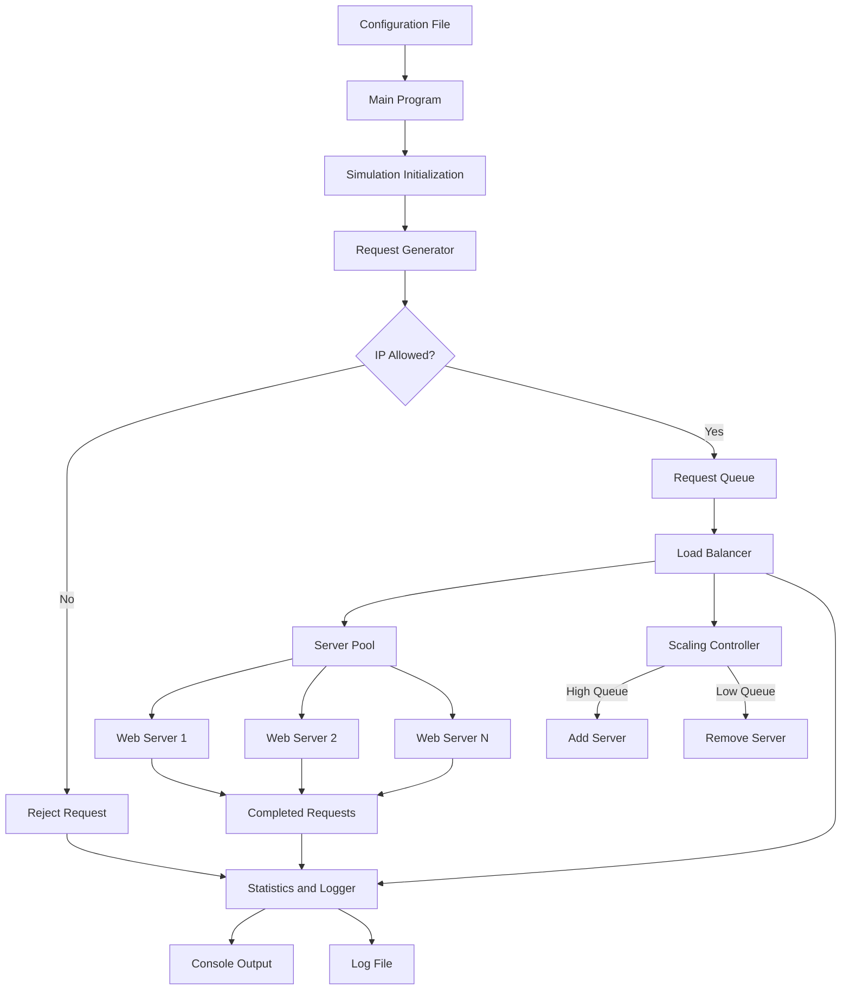
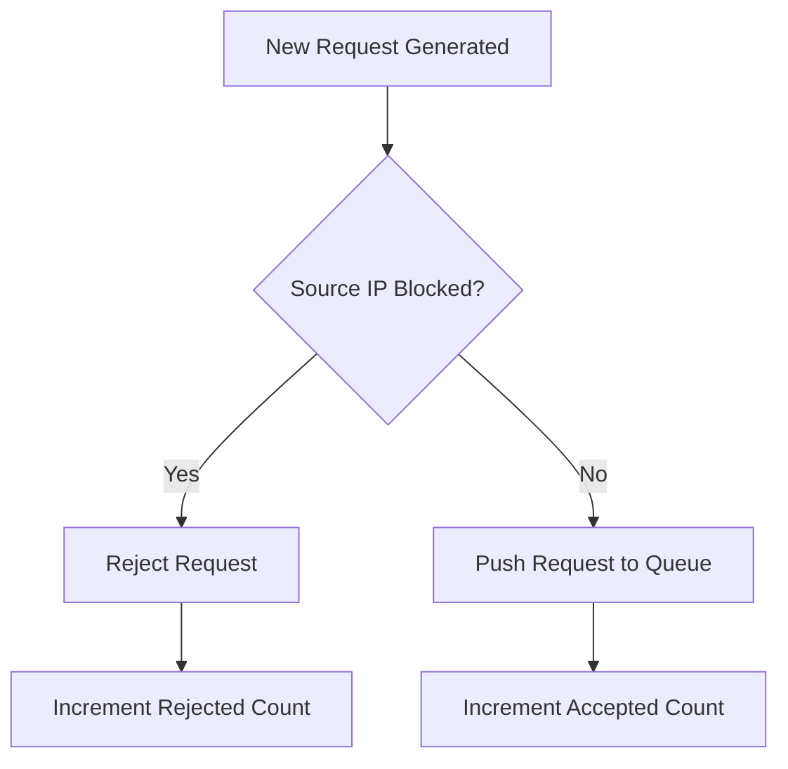
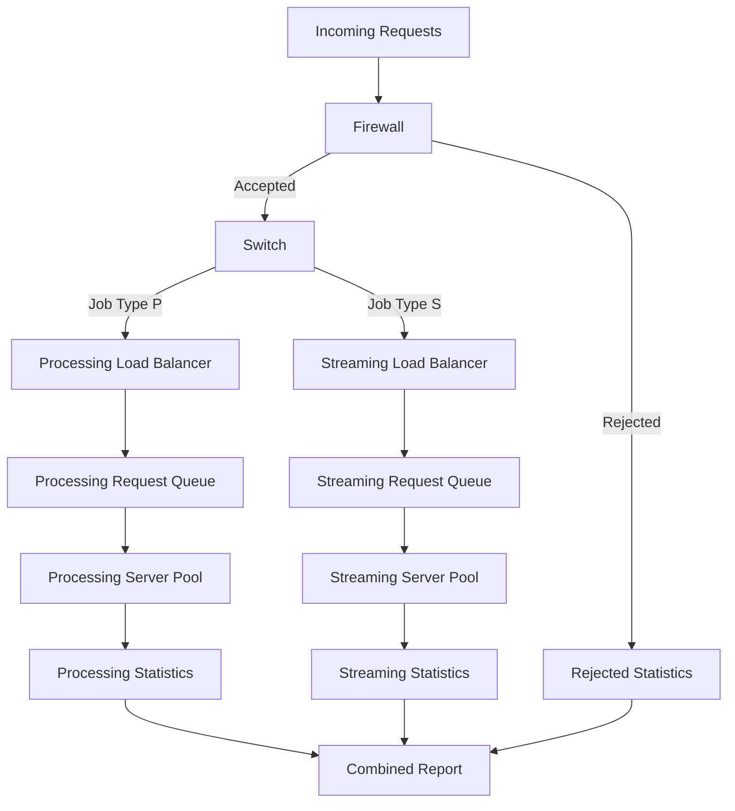
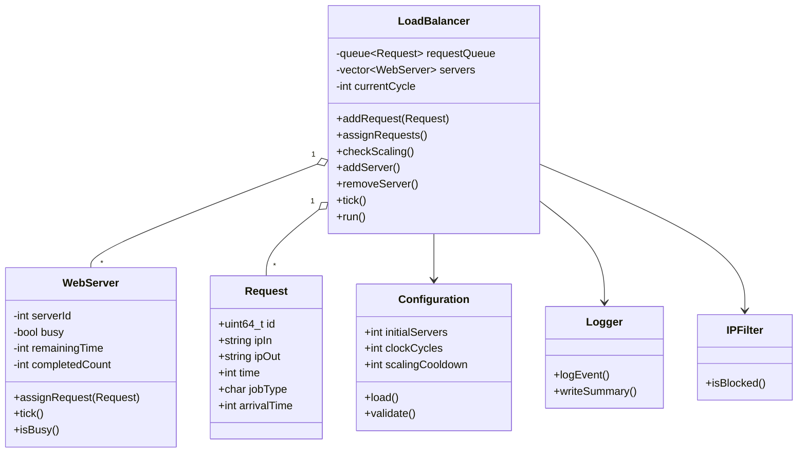

# Project 4 — Load Balancer
## Complete Project Description, Architecture, and Implementation Roadmap

**Language:** C++  
**Project Type:** Discrete-Time Load Balancer Simulation  
**Total Project Value:** 100 points  
**Additional Log Assignment:** 80 points  
**Additional Documentation Assignment:** 100 points  
**Additional Git Repository Assignment:** 20 points  
**Submission Deadline:** Sunday, 11:59 PM (verify the date in Canvas)

---

# 1. Project Overview

## 1.1 Objective

The purpose of this project is to design, implement, and demonstrate a simulated load-balancing system written in C++.

The system will model how a large company distributes incoming web requests across multiple servers, ensuring that requests are processed efficiently while maintaining an appropriate number of active servers.

Instead of implementing real networking, the program will simulate web requests and their execution using **clock cycles**.

The simulation must demonstrate:

1. Generating randomized web requests.
2. Maintaining requests in a queue.
3. Assigning requests to available web servers.
4. Simulating request processing over time.
5. Dynamically allocating and deallocating servers depending on demand.
6. Preventing requests from prohibited IP address ranges.
7. Recording events and generating meaningful execution summaries.
8. Supporting both verbose and quiet logging modes.
9. Allowing configuration without modifying the source code.
10. Producing comprehensive Doxygen documentation.

**Optional extra credit:** Implement a higher-level switch that routes processing and streaming requests to separate load balancers running concurrently.

## 1.2 Expected Behavior

At the beginning of the simulation:

- The user specifies the initial number of servers.
- The user specifies the number of clock cycles to simulate.
- The load balancer generates an initial queue of approximately 100 requests per server.
- Each request contains randomly generated IP addresses, a processing duration, and a job type.

During the simulation:

- Available servers receive queued requests.
- Servers process their assigned requests over multiple clock cycles.
- Completed servers become available to receive additional requests.
- New requests arrive at random intervals.
- The load balancer continuously measures its queue size.
- Servers are added or removed when the queue becomes too large or too small.
- Requests originating from blocked IP ranges are rejected.
- Significant simulation events are logged.

At the end:

- The simulation stops after the configured clock cycles.
- The program generates a comprehensive summary.
- The log shows what happened throughout the simulation.
- The log identifies the final condition of the load balancer and servers.

**Important:** The simulation should not simply process all requests immediately. Each request must consume its specified number of clock cycles, making the system behave like a real queue of asynchronous workloads.

---

# 2. Assignment Requirements

## 2.1 Mandatory Features

| Feature | Description | Required |
|---|---|---|
| Request struct | Stores source IP, destination IP, duration, job type | Yes |
| WebServer class | Processes assigned requests | Yes |
| LoadBalancer class | Manages queue, servers, and time | Yes |
| Request queue | FIFO collection of pending requests | Yes |
| Initial requests | Approximately 100 requests per starting server | Yes |
| Random arrivals | Generate incoming requests during execution | Yes |
| Dynamic scaling | Add and remove servers according to queue size | Yes |
| Scaling cooldown | Wait a configurable number of cycles between adjustments | Yes |
| Firewall | Block requests from configured IP ranges | Yes |
| Configuration | Settings editable outside source code | Yes |
| Verbose mode | Log meaningful simulation events | Yes |
| Quiet mode | Log starting and ending summaries | Yes |
| File logging | Write simulation information to a log file | Yes |
| Console colors | Distinguish event types using color | Yes |
| Makefile | Compile all required C++ files | Yes |
| Doxygen | Document code and generate HTML | Yes |
| Website hosting | Host design and documentation on people.tamu.edu | Yes |
| Git repository | Maintain project source in version control | Yes |
| Demonstration | Show functionality in a video | Yes |
| Switch | Route processing and streaming requests | Bonus |
| Concurrent balancers | Run separate load balancer simulations together | Bonus |

## 2.2 Required Simulation Configuration

The log submission specifically requires the following scenario:

| Parameter | Required Value |
|---|---|
| Initial web servers | 20 |
| Total clock cycles | 100,000 |
| Starting requests | Approximately 2,000 |
| Logging mode | Quiet |
| Request processing time | Configurable, report actual range |
| Scaling behavior | Enabled |
| Random request arrivals | Enabled |
| Firewall | Enabled |

The simulation must be capable of running this scenario successfully.

---

# 3. System Architecture

The recommended implementation consists of four primary components:

1. `Request` — represents an individual web request.
2. `WebServer` — executes one request at a time.
3. `LoadBalancer` — distributes jobs, maintains the queue, and adjusts server capacity.
4. `Configuration` — stores configurable simulation parameters.

Additional supporting components:

- `Logger` — manages console and file output.
- `IPFilter` — validates addresses against blocked IP ranges.
- `Switch` — routes requests to separate load balancers (bonus).

## 3.1 High-Level Architecture



### Architecture Description

The main program reads the simulation configuration and initializes the load balancer.

Requests are generated at startup and periodically during execution. Each request first passes through an IP filter.

Accepted requests enter a FIFO queue maintained by the load balancer.

The load balancer assigns queued requests to available servers. Each server simulates execution for the duration specified by the request.

The load balancer also monitors its queue size and adjusts the server pool to respond to changes in demand.

Statistics are collected throughout the simulation, and relevant events are written to the console and log file.

---

# 4. Project Directory Structure

Use multiple header and implementation files.

Recommended structure:

```text
Project4-LoadBalancer/
│
├── README.md
├── Makefile
├── Doxyfile
├── .gitignore
│
├── config/
│   └── config.txt
│
├── include/
│   ├── Request.h
│   ├── WebServer.h
│   ├── LoadBalancer.h
│   ├── Configuration.h
│   ├── Logger.h
│   └── IPFilter.h
│
├── src/
│   ├── main.cpp
│   ├── WebServer.cpp
│   ├── LoadBalancer.cpp
│   ├── Configuration.cpp
│   ├── Logger.cpp
│   └── IPFilter.cpp
│
├── logs/
│   └── .gitkeep
│
├── docs/
│   ├── design/
│   │   └── index.html
│   └── doxygen/
│
├── tests/
│   └── TEST_PLAN.md
│
└── bonus/
    ├── Switch.h
    └── Switch.cpp
```

The bonus files may instead be placed directly in `include/` and `src/` if the bonus is implemented.

### File Responsibilities

| File | Responsibility |
|---|---|
| `main.cpp` | User input, configuration loading, simulation setup, and execution |
| `Request.h` | Request data structure |
| `WebServer.h/.cpp` | Individual server state and request processing |
| `LoadBalancer.h/.cpp` | Queue management, scheduling, clock cycles, and scaling |
| `Configuration.h/.cpp` | Loading and validating settings |
| `Logger.h/.cpp` | Verbose/quiet output and statistics reporting |
| `IPFilter.h/.cpp` | IP range matching and request rejection |
| `Switch.h/.cpp` | Bonus request routing |
| `config.txt` | Runtime configuration |
| `Makefile` | Build instructions |
| `Doxyfile` | Documentation configuration |
| `README.md` | Project overview and usage |
| `docs/design/index.html` | Pre-deliverable design webpage |

The essential request, web server, and load balancer classes must be clearly documented.

---

# 5. Implementation Roadmap

The project should be built in the following order.

**Do not begin with the bonus features.** Complete and verify the mandatory simulation first.

## Phase 1 — Complete the System Design

### Step 1. Define All Required Components

Before implementing the project, decide what data each class owns and which operations it will expose.

Document:

- Class names.
- Member variables.
- Constructors.
- Public methods.
- Private helper methods.
- Method parameters.
- Return types.
- Relationships between classes.
- Overall execution sequence.

This is explicitly required by the assignment's AI-use instructions.

### Step 2. Define the Simulation Rules

Specify the following decisions before coding:

1. When does a request begin executing?
2. Does a request with duration 5 finish after exactly 5 cycles?
3. When during a cycle are new requests generated?
4. Can a server immediately receive a new request after finishing one?
5. What happens when a server is removed while processing a request?
6. How frequently does autoscaling run?
7. What happens when the queue becomes empty?
8. How are rejected requests counted?
9. What happens to unfinished requests when the simulation ends?

Write these decisions in the design document.

### Step 3. Establish a Clock-Cycle Contract

Use a consistent event order.

Recommended:

```text
For each clock cycle:

1. Advance all currently busy servers.
2. Record any requests that finish.
3. Generate newly arriving requests.
4. Validate new requests through the firewall.
5. Place accepted requests into the queue.
6. Evaluate autoscaling if cooldown permits.
7. Assign queued requests to idle servers.
8. Update statistics.
9. Record relevant events.
```

This order ensures deterministic simulation behavior given the same random seed.

Newly assigned requests should not have their remaining processing time reduced until the following cycle.

An alternative ordering is valid, but the implementation must use one consistent definition.

### Phase 1 Completion Criteria

- [ ] Class responsibilities defined.
- [ ] Data ownership established.
- [ ] Method interfaces designed.
- [ ] Clock-cycle behavior documented.
- [ ] Scaling behavior specified.
- [ ] Design diagram completed.
- [ ] Written architecture description completed.

---

# 6. Phase 2 — Implement the Request Structure

## Step 4. Design the Request Data Structure

Every request must contain:

| Field | Type | Meaning |
|---|---|---|
| `ipIn` | `std::string` | Requesting client's IP address |
| `ipOut` | `std::string` | Destination IP address |
| `time` | `int` | Processing time in clock cycles |
| `jobType` | `char` | `P` for processing or `S` for streaming |

Recommended additional fields:

| Field | Type | Meaning |
|---|---|---|
| `id` | `uint64_t` | Unique request identifier |
| `arrivalTime` | `int` | Clock cycle when request entered system |

**Recommendation:** Keep `Request` as a simple struct instead of implementing an unnecessarily complicated class.

## Step 5. Implement Random Request Generation

Create a function that generates a new request.

Its responsibilities should include:

1. Generate a unique request ID.
2. Generate a randomized source IP address.
3. Generate a randomized destination IP address.
4. Generate a processing time within a configured range.
5. Randomly select either processing or streaming.
6. Record the request's creation cycle.

### Random IP Address Generation

A request may use IPv4 dotted-decimal notation:

```text
192.168.12.45
10.25.4.100
172.16.20.50
203.0.113.25
```

For general simulation purposes, four octets in the range 0–255 produce syntactically valid IPv4 addresses.

A more realistic generator can limit generated addresses to chosen pools.

To test firewall behavior reliably, configure a percentage of generated requests to use addresses within blocked ranges.

Without this feature, random requests might almost never encounter the configured firewall rules.

### Random Processing Duration

Example:

```text
Minimum duration: 10 clock cycles
Maximum duration: 100 clock cycles
```

Use a random integer generator that includes both endpoints.

Recommended C++ facilities:

```cpp
#include <random>
```

Use one properly seeded random engine rather than reseeding on each function call.

Make the seed configurable to support reproducible testing.

### Phase 2 Completion Criteria

- [ ] Request struct created.
- [ ] Each required request field exists.
- [ ] Request IDs are unique.
- [ ] IP addresses use valid IPv4 format.
- [ ] Processing time stays within configured limits.
- [ ] Job type is `P` or `S`.
- [ ] Random generation can be tested reproducibly.

---

# 7. Phase 3 — Implement the WebServer Class

## Step 6. Define the Server State

A web server processes only one request at a time.

The class should maintain:

| Variable | Purpose |
|---|---|
| `serverId` | Unique server identifier |
| `busy` | Whether the server is processing |
| `currentRequest` | Currently assigned request |
| `remainingTime` | Cycles remaining for processing |
| `completedCount` | Requests completed by this server |
| `busyCycles` | Total cycles spent processing |

Optional state:

- Total idle cycles.
- Cumulative request execution time.
- Server creation time.
- Server retirement status.

## Step 7. Design Server Methods

Recommended interface:

| Method | Inputs | Return | Description |
|---|---|---|---|
| Constructor | Server ID | N/A | Initialize a server |
| `isBusy()` | None | `bool` | Check whether processing |
| `assignRequest()` | Request | Success/failure | Assign a request to an idle server |
| `tick()` | None | Completion information | Advance processing by one cycle |
| `getServerId()` | None | Integer | Obtain server ID |
| `getCompletedCount()` | None | Integer | Retrieve completed request count |
| `getBusyCycles()` | None | Integer | Retrieve total busy cycles |

The exact function names and signatures should be established during design.

## Step 8. Implement Request Execution

Example:

```text
Server 3 receives Request 104

Request processing time: 4 cycles

Assignment:
    remainingTime = 4

Cycle 1:
    remainingTime = 3

Cycle 2:
    remainingTime = 2

Cycle 3:
    remainingTime = 1

Cycle 4:
    remainingTime = 0
    Request completed
    Server becomes idle
```

When a request finishes:

- Increment the completion counter.
- Clear the active request.
- Mark the server available.
- Report completion to the load balancer.

The load balancer is responsible for providing the next request.

**Design principle:** The web server should not directly manipulate the global request queue.

## Step 9. Test the WebServer Independently

Before building the full simulation, validate the server in isolation.

Test cases:

| Test | Expected Result |
|---|---|
| Assign a request to idle server | Assignment succeeds |
| Assign another request while busy | Assignment rejected |
| Process request for exact duration | Completes after correct number of cycles |
| Query newly created server | Reports idle |
| Query server after completion | Reports idle |
| Complete several sequential requests | Completion counter increases correctly |

### Phase 3 Completion Criteria

- [ ] Servers can receive requests.
- [ ] Servers process requests over time.
- [ ] Servers correctly become idle.
- [ ] Completed request counts are correct.
- [ ] Busy-cycle statistics are accurate.
- [ ] Servers cannot accept concurrent jobs unintentionally.

---

# 8. Phase 4 — Implement the LoadBalancer

This is the most important component.

## Step 10. Define Load Balancer Responsibilities

The load balancer must:

1. Own the pending request queue.
2. Own and manage the server collection.
3. Track the current clock cycle.
4. Assign pending requests to available servers.
5. Process server completions.
6. Add and remove servers.
7. Track queue and server statistics.
8. Coordinate random arrivals and firewall decisions.
9. Provide information to the logger.

## Step 11. Define Core Data Structures

Recommended:

```cpp
std::queue<Request>
```

For server storage:

```cpp
std::vector<std::unique_ptr<WebServer>>
```

The use of `std::unique_ptr` is recommended because the assignment requires dynamic server allocation and deallocation.

It provides:

- Dynamic object creation.
- Automatic cleanup.
- Clear ownership of server objects.
- Reduced risk of memory leaks.

Additional counters should track how many requests were processed, rejected, and generated.

## Step 12. Define Load Balancer Methods

Recommended interface design:

| Method | Responsibility |
|---|---|
| Constructor | Initialize queue, configuration, and servers |
| `addRequest()` | Accept an incoming request |
| `assignRequests()` | Distribute queued requests to idle servers |
| `tick()` | Execute one simulation cycle |
| `addServer()` | Dynamically create a server |
| `removeServer()` | Remove an eligible server |
| `checkScaling()` | Evaluate queue thresholds |
| `run()` | Execute configured clock cycles |
| `getQueueSize()` | Retrieve waiting request count |
| `getServerCount()` | Retrieve active server count |
| `getStatistics()` | Return collected performance metrics |

Avoid placing all logic directly inside `main()`.

Instead, `main()` should configure the simulation and call the load balancer's public interface.

## Step 13. Implement Request Assignment

Use first-in, first-out scheduling.

Algorithm:

```text
For each idle server:

    If request queue is not empty:

        Remove oldest request from queue.

        Assign it to the server.

        Record assignment statistics.

        Log assignment when verbose logging is enabled.
```

The `std::queue` container provides:

- `front()` — inspect oldest request.
- `pop()` — remove oldest request.
- `push()` — add a new request.
- `empty()` — check if queue contains requests.
- `size()` — retrieve queue length.

## Step 14. Implement the Simulation Loop

High-level pseudocode:

```text
Initialize simulation.

Generate initial requests.

FOR cycle = 1 TO configuredClockCycles:

    Update all servers.

    Record completed requests.

    Generate random incoming requests.

    Filter and enqueue accepted requests.

    Evaluate whether scaling is permitted.

    Add/remove servers when necessary.

    Assign requests to available servers.

    Update statistics.

    Log meaningful events.

END FOR

Generate final summary.
```

The final implementation should account for multiple requests finishing in the same clock cycle.

### Phase 4 Completion Criteria

- [ ] Queue stores `Request` objects.
- [ ] Load balancer owns multiple servers.
- [ ] Requests are assigned FIFO.
- [ ] Idle servers obtain new jobs.
- [ ] Completed jobs are correctly counted.
- [ ] Clock cycles advance consistently.
- [ ] Simulation terminates after configured cycles.

---

# 9. Phase 5 — Dynamic Server Scaling

Dynamic scaling is one of the central grading requirements.

## Step 15. Understand the Scaling Thresholds

The assignment specifies that the load balancer should generally maintain a queue of:

- Lower threshold: 50 requests per server.
- Upper threshold: 80 requests per server.

Let:

- \(Q\) = pending request queue size.
- \(S\) = current server count.

Then:

**Lower threshold**

\[
L = 50S
\]

**Upper threshold**

\[
U = 80S
\]

Scaling rules:

| Condition | Action |
|---|---|
| \(Q < 50S\) | Remove one server |
| \(50S \leq Q \leq 80S\) | Keep server count unchanged |
| \(Q > 80S\) | Add one server |

These inequalities are strict outside the band. At exactly either boundary, no scaling is necessary.

## Step 16. Example With 20 Servers

For \(S = 20\):

\[
L = 50(20)=1000
\]

\[
U = 80(20)=1600
\]

| Queue Size | Decision |
|---|---|
| 700 | Scale down |
| 999 | Scale down |
| 1,000 | No change |
| 1,300 | No change |
| 1,600 | No change |
| 1,601 | Scale up |
| 2,000 | Scale up |

The initially generated queue contains approximately 2,000 requests.

Therefore, the first scaling evaluation will likely trigger scale-up.

This is expected.

## Step 17. Scaling Cooldown

Without a cooldown, the system could repeatedly create or remove servers every clock cycle.

Introduce a configurable cooldown.

Example:

```text
scaling_cooldown = 100
```

A server adjustment can occur only when at least 100 clock cycles have passed since the previous adjustment.

Example timeline:

```text
Cycle 0:
    Servers = 20
    Queue = 2000
    Add one server

Cycle 1–99:
    No additional scaling adjustments

Cycle 100:
    Recalculate thresholds and evaluate scaling

Cycle 200:
    Scaling may be evaluated again
```

Use a variable such as:

```text
lastScalingCycle
```

Do not recompute scaling thresholds using only the initial server count.

**Thresholds must always use the current server count.**

## Step 18. Implement Scale-Up

When the queue exceeds the upper threshold:

1. Verify scaling cooldown has elapsed.
2. Verify maximum server count has not been reached.
3. Allocate a new `WebServer`.
4. Assign the new server a unique ID.
5. Add the server to the server collection.
6. Increment scale-up statistics.
7. Record the event in the log.
8. Update the last scaling cycle.

Example event:

```text
[CYCLE 1500] [SCALE UP]

Queue size: 1842
Previous servers: 20
New servers: 21
Reason: Queue exceeded upper threshold
```

## Step 19. Implement Scale-Down

When the queue falls below the lower threshold:

1. Verify cooldown has elapsed.
2. Verify minimum server count will not be violated.
3. Find an idle server.
4. Remove the server from the collection.
5. Increment scale-down statistics.
6. Log the server removal.
7. Update the last scaling cycle.

### Important: Never Abandon an Active Request

A server currently processing a request should not be destroyed without deciding how that request will be handled.

Recommended approach:

**Remove only idle servers.**

If no idle servers exist:

- Defer the scale-down operation.
- Continue processing.
- Retry during a future eligible scaling evaluation.

An alternative is to mark a busy server for retirement and remove it after its current request completes.

This requires additional state but is also acceptable.

## Step 20. Configure Scaling Limits

Recommended settings:

```text
min_servers = 1
max_servers = 100
```

The minimum prevents accidentally removing every server.

The maximum prevents unbounded server creation.

Log attempted scaling events that were blocked by these limits, particularly in verbose mode.

## Step 21. Understand the Limits of the Threshold Policy

The threshold policy is an assignment requirement, not a guarantee that queue size will always remain within the desired interval.

The queue may temporarily exceed the upper threshold because scaling occurs one server at a time and is constrained by cooldowns.

It may also fall below the lower threshold when arrivals slow down.

This is expected in a simulation with random workloads.

Track how frequently the queue is outside the target range to evaluate the effectiveness of the configuration.

### Phase 5 Completion Criteria

- [ ] Correct dynamic thresholds.
- [ ] Scale-up triggers above upper threshold.
- [ ] Scale-down triggers below lower threshold.
- [ ] Scaling cooldown enforced.
- [ ] Server minimum and maximum enforced.
- [ ] Busy servers are not destroyed unexpectedly.
- [ ] Scaling actions recorded.
- [ ] Dynamic allocation and deallocation work correctly.

---

# 10. Phase 6 — Random Request Arrivals

## Step 22. Simulate Incoming Traffic

The assignment requires new requests to arrive at random times after the initial queue is generated.

Do not rely exclusively on the initial requests.

The simulation should continue receiving requests throughout its lifetime.

### Recommended Arrival Model

Use a configurable probability of generating a new batch of requests each clock cycle.

Example:

```text
arrival_probability = 0.10
arrival_batch_min = 1
arrival_batch_max = 5
```

Interpretation:

- Every clock cycle has a 10% chance of receiving a new batch.
- When a batch arrives, its size is between 1 and 5.

This produces variation in the workload.

### Alternative: Random Arrival Intervals

Instead of independently evaluating every clock cycle:

1. Randomly choose the next arrival cycle.
2. Wait until that cycle.
3. Generate one or more requests.
4. Choose another arrival cycle.

Either method is acceptable.

## Step 23. Tune Traffic Volume

The incoming request rate and processing time range must be balanced.

Otherwise, the simulation may either:

- Drain the queue too quickly.
- Accumulate a massive backlog.
- Continuously scale to its maximum.
- Leave nearly every server idle.

A useful approximate relationship is:

\[
\text{Processing Capacity}
\approx
\frac{S}{E[T]}
\]

where:

- \(S\) = active servers.
- \(E[T]\) = average processing duration.

For example, with 20 servers and an average duration of 50 cycles:

\[
\frac{20}{50}=0.4
\]

This means the system can complete approximately 0.4 requests per clock cycle under steady conditions.

The expected incoming arrival rate should be reasonably close to processing capacity if the objective is to demonstrate stable operation.

An initial queue of 2,000 requests is much larger than the target range, so early scaling and queue reduction are expected.

## Step 24. Make Randomness Reproducible

Include a random seed in the configuration.

Example:

```text
random_seed = 12345
```

A fixed seed makes it easier to:

- Reproduce simulation results.
- Debug unexpected behavior.
- Compare configurations.
- Produce a consistent log for submission.

The program may also support a random seed generated from the system.

Record the actual seed in the final log.

### Phase 6 Completion Criteria

- [ ] Requests arrive after initialization.
- [ ] Arrival timing is randomized.
- [ ] Request volume is configurable.
- [ ] Random seed is recorded.
- [ ] Traffic can be tuned to demonstrate scaling.

---

# 11. Phase 7 — Implement the Firewall

## Step 25. Define the Firewall's Purpose

The firewall prevents incoming requests from specified IP address ranges from entering the processing queue.

A rejected request:

- Must not enter the queue.
- Must not occupy a server.
- Must increase the rejection counter.
- Should be recorded in verbose logging.

## Step 26. Choose IP Range Representation

The recommended approach is CIDR notation.

Examples:

```text
192.168.0.0/16
10.0.0.0/8
203.0.113.0/24
```

CIDR notation describes a group of IP addresses using a network address and prefix length.

For example:

```text
203.0.113.0/24
```

covers:

```text
203.0.113.0
through
203.0.113.255
```

Alternatively, explicit start/end IP pairs can be used if CIDR parsing is too complicated.

## Step 27. Implement Address Validation

Recommended approach:

1. Convert each IPv4 address into a 32-bit unsigned integer.
2. Convert the configured network address into the same representation.
3. Construct a bitmask from the prefix length.
4. Apply the mask to both addresses.
5. Compare the results.

For a valid `/24` network:

```text
IP:      203.0.113.45
Network: 203.0.113.0/24

Result: BLOCKED
```

Use `uint32_t` and unsigned operations for clarity.

Carefully handle prefix lengths of `/0` and `/32` to avoid invalid bit shifts.

Malformed IP addresses and invalid CIDR values should be detected during configuration parsing.

## Step 28. Integrate the Firewall

Request admission pipeline:



Filtering should occur before adding a request to the queue.

For this project, the firewall should normally inspect the incoming source IP (`ipIn`), not the destination IP.

## Step 29. Test Firewall Behavior

Test:

- Address exactly at beginning of a blocked range.
- Address exactly at end of a blocked range.
- Address immediately outside a blocked range.
- Addresses in completely unrelated ranges.
- Multiple overlapping blocked ranges.
- Invalid IP and CIDR configurations.

### Phase 7 Completion Criteria

- [ ] IP blocking rules configurable.
- [ ] Blocked requests rejected.
- [ ] Allowed requests accepted.
- [ ] Rejection counters increment correctly.
- [ ] Rejected requests never reach servers.
- [ ] Firewall behavior appears in logs.

---

# 12. Phase 8 — Configuration System

## Step 30. Create a Configuration File

A sample plain-text configuration:

```ini
# Simulation
initial_servers=20
clock_cycles=100000

# Request generation
initial_requests_per_server=100
request_time_min=10
request_time_max=100
random_seed=12345

# Random arrivals
arrival_probability=0.10
arrival_batch_min=1
arrival_batch_max=5
blocked_request_probability=0.05

# Scaling
lower_queue_threshold=50
upper_queue_threshold=80
scaling_cooldown=100
min_servers=1
max_servers=100

# Logging
log_mode=quiet
log_file=logs/simulation.log
enable_colors=true

# Firewall
blocked_ranges=203.0.113.0/24,198.51.100.0/24
```

These are example parameters, not guaranteed optimal settings.

Tune them after running tests.

### Important Configuration Requirements

Allow configuration of:

- Initial server count.
- Simulation duration.
- Request duration range.
- Initial queue multiplier.
- Arrival generation behavior.
- Scaling thresholds and cooldown.
- Minimum and maximum servers.
- Blocked IP ranges.
- Logging mode.
- Log output location.
- Random seed.

The initial server count and duration should also be adjustable through user input or command-line arguments.

## Step 31. Implement Configuration Parsing

The parser should:

1. Open the configuration file.
2. Read it line by line.
3. Ignore blank lines.
4. Ignore comments.
5. Parse `key=value` pairs.
6. Convert values to appropriate types.
7. Validate numeric boundaries.
8. Apply supported defaults.
9. Report invalid configurations.

Examples of invalid settings:

```text
initial_servers=-10
clock_cycles=0
request_time_min=100
request_time_max=10
arrival_probability=5.0
scaling_cooldown=-20
```

Such settings should produce understandable errors.

## Step 32. Support Command-Line Overrides

Suggested usage:

```bash
./loadbalancer --config config/config.txt
```

Or:

```bash
./loadbalancer --servers 20 --cycles 100000 --quiet
```

Or:

```bash
./loadbalancer --servers 5 --cycles 1000 --verbose
```

A useful priority order is:

```text
Built-in defaults
       ↓
Configuration file
       ↓
Command-line arguments
       ↓
Optional interactive user input
```

Command-line values override configuration values.

Interactive prompts should be used only when needed so automated execution remains practical.

### Phase 8 Completion Criteria

- [ ] Config file loads correctly.
- [ ] Program runs without source edits.
- [ ] Invalid configuration is detected.
- [ ] Users can configure servers and cycles.
- [ ] Quiet and verbose modes selectable.
- [ ] Parameters can be changed for experiments.

---

# 13. Phase 9 — Logging and Statistics

This phase directly addresses the 80-point log rubric.

## Step 33. Implement Two Logging Modes

### Quiet Mode

Quiet mode should output:

1. Simulation configuration.
2. Initial status.
3. Final status.
4. Summary of important events.
5. Aggregate statistics.

It should not print each clock cycle or each individual request assignment.

### Verbose Mode

Verbose mode should output:

- Initial simulation status.
- New request batches.
- Selected request assignments.
- Request completions.
- Blocked requests.
- Server additions.
- Server removals.
- Cooldown or scaling limit events when useful.
- Final statistics.

Verbose mode should still avoid meaningless clock-by-clock output.

**Requirement:** The generated log file should contain useful information, not merely a copy of every simulation loop iteration.

## Step 34. Design the Statistics Structure

Track at least the following:

### Request Statistics

- Total requests generated.
- Total requests accepted.
- Total requests rejected.
- Total requests assigned.
- Total requests completed.
- Requests still waiting.
- Requests still processing.
- Total completed processing time.

### Queue Statistics

- Starting queue size.
- Ending queue size.
- Minimum observed queue size.
- Maximum observed queue size.
- Average queue size.
- Number of cycles below lower threshold.
- Number of cycles within target range.
- Number of cycles above upper threshold.

### Server Statistics

- Starting server count.
- Ending server count.
- Minimum active server count.
- Maximum active server count.
- Total servers created.
- Total servers removed.
- Number of scaling operations.
- Total busy server-cycles.
- Total available server-cycles.

### Timing Statistics

- Configured simulation duration.
- Request duration range.
- Average completion duration.
- Average queue waiting time.
- Maximum queue waiting time.

### Firewall Statistics

- Blocked IP ranges.
- Total rejected requests.
- Rejection percentage.

## Step 35. Compute Useful Performance Metrics

### Average Queue Size

\[
\text{Average Queue Size}
=
\frac{\sum_{t=1}^{N}Q_t}{N}
\]

where \(Q_t\) is the queue size measured at the end of cycle \(t\).

### Average Server Utilization

\[
\text{Utilization}
=
\frac{\text{Total Busy Server-Cycles}}
{\text{Total Available Server-Cycles}}
\times100
\]

The denominator must account for the number of servers actually existing during each cycle.

Using only the starting server count would be incorrect when dynamic scaling is enabled.

### Request Throughput

\[
\text{Throughput}
=
\frac{\text{Completed Requests}}
{\text{Simulation Clock Cycles}}
\]

### Firewall Rejection Rate

\[
\text{Rejection Rate}
=
\frac{\text{Rejected Requests}}
{\text{Generated Requests}}
\times100
\]

### Average Queue Wait Time

\[
\text{Average Wait}
=
\frac{\sum(\text{Assignment Cycle}-\text{Arrival Cycle})}
{\text{Number of Assigned Requests}}
\]

This measures how long requests wait before receiving a server.

## Step 36. Verify Request Accounting

One of the most important correctness checks is ensuring that requests never disappear or get counted twice.

At the end of the simulation:

\[
\text{Generated}
=
\text{Rejected}
+
\text{Completed}
+
\text{Waiting}
+
\text{In Progress}
\]

Assuming no other discard mechanism exists, this invariant must always hold.

It is possible to finish the simulation with active servers processing requests.

Those requests should be counted as **in progress**, not as completed.

If tracking assignments:

\[
\text{Assigned}
=
\text{Completed}
+
\text{In Progress}
\]

These relationships are excellent debugging tools.

---

# 14. Required 100,000-Cycle Log

## Step 37. Run the Required Scenario

Execute:

```bash
./loadbalancer --servers 20 --cycles 100000 --quiet
```

Ensure the run uses the intended processing-time range and configuration.

Do not substitute a shorter simulation.

The resulting log must provide:

1. Starting queue size.
2. Ending queue size.
3. Request time range.
4. At least three additional meaningful metrics.
5. Dynamic server information.
6. Remaining requests.
7. Rejected/discarded requests.
8. Final server status.

## Step 38. Recommended Quiet Log Format

The following is a **format template with illustrative placeholders**, not actual measured simulation results.

```text
========================================================
              LOAD BALANCER SIMULATION
                     QUIET MODE
========================================================

SIMULATION CONFIGURATION
--------------------------------------------------------
Initial Servers:                 20
Total Clock Cycles:              100000
Initial Requests per Server:     100
Request Processing Range:        10 - 100 cycles
Lower Queue Threshold:           50 requests/server
Upper Queue Threshold:           80 requests/server
Scaling Cooldown:                100 cycles
Random Seed:                     12345
Firewall:                        ENABLED

INITIAL SYSTEM STATUS
--------------------------------------------------------
Starting Queue Size:             <measured>
Starting Active Servers:         20
Starting Busy Servers:           0
Starting Idle Servers:           20

REQUEST STATISTICS
--------------------------------------------------------
Total Requests Generated:        <measured>
Total Requests Accepted:         <measured>
Total Requests Rejected:         <measured>
Total Requests Assigned:         <measured>
Total Requests Completed:        <measured>
Requests Still Processing:       <measured>
Requests Still in Queue:         <measured>

QUEUE STATISTICS
--------------------------------------------------------
Starting Queue Size:             <measured>
Ending Queue Size:               <measured>
Minimum Queue Size:              <measured>
Maximum Queue Size:              <measured>
Average Queue Size:              <measured>
Average Waiting Time:            <measured>
Cycles Below Target:             <measured>
Cycles Within Target:            <measured>
Cycles Above Target:             <measured>

SERVER STATISTICS
--------------------------------------------------------
Starting Servers:                20
Ending Servers:                  <measured>
Minimum Active Servers:          <measured>
Maximum Active Servers:          <measured>
Servers Created:                 <measured>
Servers Removed:                 <measured>
Scale-Up Events:                 <measured>
Scale-Down Events:               <measured>
Busy Servers at End:             <measured>
Idle Servers at End:             <measured>
Average Utilization:             <measured> %

FIREWALL STATISTICS
--------------------------------------------------------
Rejected Requests:               <measured>
Rejection Rate:                  <measured> %
Blocked IP Ranges:               <configured ranges>

PERFORMANCE SUMMARY
--------------------------------------------------------
Throughput:                      <measured> req/cycle
Average Processing Time:         <measured> cycles
Average Queue Waiting Time:      <measured> cycles

FINAL SYSTEM STATUS
--------------------------------------------------------
Final Clock Cycle:               100000
Remaining Requests in Queue:     <measured>
Requests Still Processing:       <measured>
Active Servers:                  <measured>
Idle Servers:                    <measured>
Rejected Requests:               <measured>

Request Accounting Check:        <PASS/FAIL>
Simulation Completed:            YES

========================================================
                 END OF SIMULATION
========================================================
```

## Step 39. Recommended Verbose Event Format

```text
[000001] [INFO]  Simulation initialized
[000001] [QUEUE] Initial request queue populated
[000001] [SCALE+] Server 21 allocated
[000001] [ASSIGN] Request 1 assigned to Server 1
[000001] [ASSIGN] Request 2 assigned to Server 2
[000024] [DONE]  Server 2 completed Request 2
[000025] [ASSIGN] Request 21 assigned to Server 2
[000080] [BLOCK] Request 2050 rejected by IP filter
[000100] [SCALE+] Server 22 allocated
[000150] [ARRIVE] New batch accepted into queue
```

These lines are illustrative examples only.

Use consistent event tags:

| Event | Color Recommendation |
|---|---|
| Information | Cyan |
| Request assignment | Blue |
| Request completed | Green |
| Scale-up | Yellow |
| Scale-down | Magenta |
| Firewall rejection | Red |
| Error | Bright red |
| Final summary | Bold white |

ANSI escape codes may be used for terminal colors.

**Important:** The written log file should preferably omit ANSI color escape sequences so it remains readable as plain text.

## Step 40. Validate the Log Against the Rubric

### Basic Logs — 30 Points

- [ ] Starting queue size present.
- [ ] Ending queue size present.
- [ ] Processing-time range present.

### Additional Information — 30 Points

- [ ] Scaling events summarized.
- [ ] Random incoming request counts present.
- [ ] Assignment counts present.
- [ ] Completion counts present.
- [ ] Processing/performance metrics included.

### End Status — 20 Points

- [ ] Remaining queued requests.
- [ ] Busy and idle servers.
- [ ] Final active server count.
- [ ] Rejected/discarded requests.
- [ ] Total scaling operations.
- [ ] Simulation completion indicated.

---

# 15. Phase 10 — Test and Tune the Simulation

## Step 41. Test Small Configurations First

Do not start debugging with 100,000 clock cycles.

Recommended testing sequence:

| Test | Servers | Cycles | Purpose |
|---|---:|---:|---|
| Basic functionality | 1 | 50 | Validate request execution |
| Queue scheduling | 2 | 200 | Verify FIFO behavior |
| Server distribution | 5 | 1,000 | Test parallel processing |
| Scaling | 10 | 5,000 | Verify dynamic allocation |
| Firewall | 5 | 1,000 | Test rejected requests |
| Moderate simulation | 20 | 10,000 | Verify stability |
| Required submission | 20 | 100,000 | Produce official log |

## Step 42. Test Extreme Scenarios

### Scenario A — Almost No Incoming Traffic

Settings:

```text
arrival_probability=0.001
```

Expected:

- Queue drains.
- Servers become idle.
- Scale-down occurs.
- Minimum server limit is respected.

### Scenario B — Heavy Incoming Traffic

Settings:

```text
arrival_probability=0.90
arrival_batch_min=5
arrival_batch_max=15
```

Expected:

- Queue grows.
- Scale-up occurs.
- Maximum server count is respected.
- No requests disappear.

### Scenario C — Long Processing Times

Settings:

```text
request_time_min=500
request_time_max=1000
```

Expected:

- Servers remain busy longer.
- Throughput decreases.
- Queue may grow.
- Scaling responds to increasing backlog.

### Scenario D — Short Processing Times

Settings:

```text
request_time_min=1
request_time_max=5
```

Expected:

- Requests finish quickly.
- Queue drains faster.
- Scaling may reduce capacity.

### Scenario E — Firewall Stress Test

Configure a high proportion of blocked source IPs.

Expected:

- Rejection count increases.
- Blocked requests never enter the queue.
- Queue receives only accepted requests.

### Scenario F — Server Removal While Busy

Cause the queue to fall below the lower scaling threshold while all servers are busy.

Expected:

- No active job is lost.
- Scale-down is deferred or retirement is scheduled.
- Request accounting remains valid.

## Step 43. Tune the Final Configuration

Experiment with:

- Request processing duration.
- Arrival probability.
- Arrival batch size.
- Scaling cooldown.
- Server minimum and maximum.
- Initial queue multiplier.

Record which configurations:

- Keep queues near the target range.
- Avoid unnecessary scaling.
- Maintain reasonable utilization.
- Finish substantial amounts of work.
- Avoid runaway queue growth.

The project objective includes learning how to prevent overloading and underutilization.

Use your measurements to explain which parameters work best.

---

# 16. Phase 11 — Bonus: Streaming and Processing Switch

**Bonus Value:** Up to 20 points.

Complete this only after the mandatory project works correctly.

## Step 44. Understand the Bonus Objective

The assignment allows a higher-level switch that routes two job types:

- `P` — Processing.
- `S` — Streaming.

Each type should be handled by a separate load balancer with its own queue and web servers.

## Step 45. Bonus Architecture



## Step 46. Design the Switch Class

Potential responsibilities:

- Accept incoming requests.
- Inspect the job type.
- Forward each request to the appropriate load balancer.
- Keep total routing statistics.
- Advance both load balancers through a shared simulation clock.
- Produce separate and combined reports.

Suggested methods:

| Method | Description |
|---|---|
| Constructor | Initialize both load balancers |
| `routeRequest()` | Dispatch by request type |
| `tick()` | Advance both simulations |
| `run()` | Execute shared simulation |
| `getStatistics()` | Combine final statistics |

## Step 47. Run Both Load Balancers Concurrently

The simplest recommended approach is **logical concurrency using one simulation clock**.

For each clock cycle:

```text
Generate incoming requests.

Route requests through the switch.

Advance processing load balancer by one cycle.

Advance streaming load balancer by one cycle.

Evaluate scaling for each load balancer.

Update combined statistics.
```

This simulates both systems operating simultaneously.

Actual operating-system threads are not necessary unless specifically desired.

The two load balancers must retain separate:

- Request queues.
- Server pools.
- Scaling decisions.
- Performance statistics.

Do not simply place all jobs into one queue and label them differently.

## Step 48. Record Separate Statistics

Example final report structure:

```text
==================================================
              SWITCH SIMULATION
==================================================

PROCESSING LOAD BALANCER
--------------------------------------------------
Generated:       <measured>
Completed:       <measured>
Queue Remaining: <measured>
Active Servers:  <measured>
Scale Events:    <measured>

STREAMING LOAD BALANCER
--------------------------------------------------
Generated:       <measured>
Completed:       <measured>
Queue Remaining: <measured>
Active Servers:  <measured>
Scale Events:    <measured>

COMBINED TOTALS
--------------------------------------------------
Requests Routed: <measured>
Requests Done:   <measured>
Requests Waiting:<measured>
Rejected:        <measured>
```

## Bonus Completion Criteria

- [ ] Separate processing and streaming queues.
- [ ] Separate load balancer instances.
- [ ] Different server pools.
- [ ] Correct job routing.
- [ ] Shared simulation timeline.
- [ ] Independent scaling.
- [ ] Separate per-balancer statistics.
- [ ] Combined final report.
- [ ] Bonus features demonstrated in video.

---

# 17. Phase 12 — Create the Makefile

## Step 49. Define Build Requirements

Your Makefile should:

1. Compile all `.cpp` implementation files.
2. Use an appropriate C++ language standard.
3. Include the header directory.
4. Link object files into the executable.
5. Support rebuilding changed files.
6. Provide a clean target.
7. Support generating documentation optionally.

Recommended targets:

```text
make
make clean
make run
make docs
```

Suggested compiler settings:

```text
Compiler: g++
C++ Standard: C++17
Warnings: -Wall -Wextra -Wpedantic
Debugging: -g
```

For testing, consider enabling AddressSanitizer and UndefinedBehaviorSanitizer in a separate debug build where supported.

## Step 50. Verify a Clean Build

From the project root:

```bash
make clean
make
```

Then execute the resulting program.

Ensure:

- All implementation files compile.
- Headers resolve correctly.
- No missing symbol errors occur.
- Program loads its configuration.
- Executable runs correctly.

The final submitted ZIP must include the Makefile and source files but **must not contain executables**.

---

# 18. Phase 13 — Doxygen Documentation

Documentation accounts for a substantial portion of the project grade.

## Step 51. Install Doxygen

Depending on the operating system:

Ubuntu/Debian:

```bash
sudo apt install doxygen graphviz
```

macOS with Homebrew:

```bash
brew install doxygen graphviz
```

## Step 52. Generate a Doxyfile

From the project directory:

```bash
doxygen -g Doxyfile
```

Edit important configuration options:

```ini
PROJECT_NAME = "Load Balancer Simulation"

PROJECT_BRIEF = "A configurable C++ dynamic load balancer"

OUTPUT_DIRECTORY = docs/doxygen

INPUT = include src README.md

RECURSIVE = YES

EXTRACT_ALL = YES

GENERATE_HTML = YES

GENERATE_LATEX = NO

HAVE_DOT = YES

CALL_GRAPH = YES

CALLER_GRAPH = YES

UML_LOOK = YES

USE_MDFILE_AS_MAINPAGE = README.md
```

If `README.md` is used as the main page, give it meaningful project content and descriptions.

## Step 53. Document Every Class

Each class should contain:

- Brief summary.
- Detailed description.
- Purpose.
- Main responsibilities.
- Documentation for methods.
- Documentation for relevant data.

Example:

```cpp
/**
 * @class WebServer
 * @brief Simulates a server that processes web requests.
 *
 * A WebServer accepts one Request at a time and
 * processes it over a configured number of clock cycles.
 *
 * The server records its busy state, remaining processing
 * time, and completed request statistics.
 */
```

## Step 54. Document Methods

Example:

```cpp
/**
 * @brief Checks whether the server is currently processing.
 *
 * @return true if the server is processing a request,
 *         false otherwise.
 */
bool isBusy() const;
```

For methods with parameters:

```cpp
/**
 * @brief Assigns a new request to the server.
 *
 * @param request The request to process.
 * @return true if assignment succeeded,
 *         false if the server is busy.
 */
bool assignRequest(const Request& request);
```

Use:

- `@brief`
- `@param`
- `@return`
- `@details`
- `@note`
- `@warning`

where appropriate.

## Step 55. Document the Request Struct

The rubric specifically evaluates the request, web server, and load balancer classes.

Ensure the documentation includes:

- The `Request` struct itself.
- Descriptions of all four required fields.
- Any additional fields.

Do not assume Doxygen automatically produces complete descriptions from bare declarations.

## Step 56. Document Main Program Behavior

Provide an overview of:

1. Reading configuration.
2. Creating the simulation.
3. Initializing servers.
4. Generating the initial queue.
5. Executing the simulation.
6. Writing reports.
7. Terminating execution.

The documentation homepage should explain the full project.

## Step 57. Generate HTML Documentation

Execute:

```bash
doxygen Doxyfile
```

Check the generated documentation locally.

Verify that the following appear:

- Request struct.
- WebServer class.
- LoadBalancer class.
- Public methods.
- Method parameters and return values.
- Class descriptions.
- Project homepage.

### Documentation Rubric Checklist

**Classes — 80 Points**

- [ ] Request documented.
- [ ] WebServer documented.
- [ ] LoadBalancer documented.
- [ ] Class descriptions meaningful.
- [ ] Methods documented.

**Website — 10 Points**

- [ ] HTML documentation hosted on people.tamu.edu.

**Main Page — 10 Points**

- [ ] Project description included.
- [ ] Main page is not empty.
- [ ] Purpose and functionality explained.

---

# 19. Phase 14 — Pre-Deliverable Design Website

The pre-deliverable is separate from the generated Doxygen documentation.

## Step 58. Create the Design Page

The professor requires:

1. A design diagram, flowchart, or UML diagram.
2. A written description of the design.
3. HTML/CSS output.
4. Visible branding.
5. Hosting on people.tamu.edu.

Recommended page structure:

```text
Load Balancer Simulation
------------------------
Project Branding / Logo

1. Project Overview

2. Design Objectives

3. System Architecture Diagram

4. Architecture Explanation

5. Class Structure / UML

6. Request Processing Workflow

7. Dynamic Scaling Algorithm

8. Configuration and Logging

9. Technology Stack

10. Author / Project Information
```

## Step 59. Recommended Branding

Create a consistent project identity.

Example brand:

**Meridian Load Systems**

Subtitle:

*Adaptive Web Request Distribution Simulator*

Suggested website design:

- Clean dark-blue or charcoal background.
- Bright blue accent colors.
- Rounded architecture panels.
- Clear flow diagrams.
- Professional typography.
- Consistent logo/heading.
- Responsive mobile layout.

Branding should be visible at the top of the page.

You can use any original brand name you prefer.

## Step 60. Create a UML Class Diagram

Recommended relationship diagram:



Use this as a starting point and adjust the method names, members, and relationships to match your actual design before submission.

The diagram must reflect the implementation, not merely a theoretical architecture.

## Step 61. Write the Diagram Description

The accompanying text should explain:

- Requests are generated randomly.
- The firewall prevents blocked traffic from entering.
- The load balancer maintains a FIFO queue.
- Available servers accept requests.
- Each server processes one request over multiple cycles.
- The load balancer monitors queue pressure.
- Scaling adds and removes server instances.
- The logger collects simulation events.
- The configuration determines runtime behavior.

Also explain why the classes are separated:

- Request stores data.
- WebServer processes data.
- LoadBalancer coordinates execution.
- Configuration manages parameters.
- Logger manages observability.
- IPFilter controls admission.

---

# 20. Phase 15 — Host Documentation on people.tamu.edu

## Step 62. Prepare Website Directories

Suggested remote structure:

```text
public_html/
└── loadbalancer/
    ├── index.html
    ├── styles.css
    ├── assets/
    │
    └── documentation/
        ├── index.html
        ├── classes.html
        └── ...
```

The root `index.html` is the branded design pre-deliverable.

The `documentation/` directory contains the complete Doxygen HTML output.

Use separate URLs for the two deliverables.

Example URL patterns:

```text
https://people.tamu.edu/~YOUR_NETID/loadbalancer/
```

```text
https://people.tamu.edu/~YOUR_NETID/loadbalancer/documentation/
```

Replace `YOUR_NETID` with your actual account information.

These URL patterns are illustrative; verify your account's actual published path.

## Step 63. Upload the Website

Use the university's supported file upload or web hosting method.

Typical hosting workflow:

1. Confirm people.tamu.edu hosting is enabled for your account.
2. Locate the website publishing directory.
3. Upload the branded HTML/CSS design page.
4. Upload the full Doxygen-generated HTML directory.
5. Preserve the relative folder structure.
6. Set appropriate file permissions where required.
7. Visit the public URLs.
8. Test every major documentation link.

Do not upload only Doxygen's `index.html`.

The generated documentation depends on additional CSS, JavaScript, and other files.

## Step 64. Verify Public Access

Open both sites in a private/incognito browser window.

Check:

- Homepage displays.
- Branding is visible.
- Architecture diagram renders.
- Doxygen pages load.
- Classes can be navigated.
- Documentation links work.
- CSS and images load.
- No university login is required for public grading access, if public hosting is supported.

### Hosting Completion Criteria

- [ ] Branded design website hosted.
- [ ] Written diagram description included.
- [ ] Doxygen output hosted.
- [ ] Documentation is accessible publicly.
- [ ] Both URLs saved for submission.

---

# 21. Phase 16 — Git Repository

## Step 65. Initialize Version Control

Create a repository for the project.

Suggested repository name:

```text
cpp-load-balancer-simulator
```

Initialize locally:

```bash
git init
git add .
git commit -m "Initial project design and structure"
```

Connect to your remote Git provider and push using its supplied repository URL.

## Step 66. Use Meaningful Commits

Recommended commit progression:

```text
Initial project design and architecture
Implement Request structure and generator
Implement WebServer processing logic
Implement LoadBalancer scheduling
Implement dynamic server scaling
Add randomized incoming requests
Implement IP range filtering
Add configurable simulation parameters
Implement verbose and quiet logging
Add statistics and final summary
Add tests and fix simulation edge cases
Add Doxygen documentation
Add Makefile and submission instructions
Implement bonus request switch
```

The point is to demonstrate actual development progression.

Do not wait until the project is finished and create only one final commit.

## Step 67. Prepare .gitignore

Exclude files such as:

```gitignore
# Compiled binaries
*.o
*.out
*.exe
loadbalancer

# Build directories
build/

# Generated logs
logs/*.log

# Temporary files
*.tmp

# Editor files
.vscode/
.idea/

# System files
.DS_Store
```

You may intentionally commit the required quiet-mode log separately, for example under a `submission/` directory.

Avoid accidentally excluding that file.

## Step 68. Final Repository Verification

Your repository should include:

- Source code.
- Header files.
- Makefile.
- Configuration example.
- README.
- Doxygen configuration.
- Design documentation.
- Testing information.

The repository should be viewable by the grader.

---

# 22. Phase 17 — Demonstration Video

The video must demonstrate actual execution and meaningful features.

## Step 69. Plan the Demonstration

Recommended order:

### Part 1 — Branded Introduction

Display:

- Project name.
- Logo or title card.
- Short description.

Explain what the load balancer simulates.

### Part 2 — Project Architecture

Show:

- Request struct.
- WebServer class.
- LoadBalancer class.
- Queue.
- Scaling controller.
- Firewall.

Briefly explain how requests flow through the system.

### Part 3 — Configuration

Open the configuration file.

Show that:

- Server count is adjustable.
- Simulation duration is adjustable.
- Request processing time is adjustable.
- Scaling settings are adjustable.
- Firewall rules are adjustable.
- Logging mode can be changed.

### Part 4 — Compile the Program

Run:

```bash
make clean
make
```

Show that the project builds successfully.

### Part 5 — Verbose Demonstration

Run a smaller simulation:

```bash
./loadbalancer --servers 5 --cycles 1000 --verbose
```

Highlight:

- Initial queue generation.
- Request assignments.
- Job completions.
- Random arrivals.
- Firewall blocks.
- Server scaling.
- Colored console output.

Use a small enough simulation to make the events understandable.

### Part 6 — Required Quiet Simulation

Show the command:

```bash
./loadbalancer --servers 20 --cycles 100000 --quiet
```

Then display its generated log.

Highlight:

- Starting queue.
- Ending queue.
- Processing-time range.
- Total requests handled.
- Final server count.
- Scaling counts.
- Rejected requests.
- Utilization.

### Part 7 — Documentation Website

Open the hosted page on people.tamu.edu.

Show:

- Branded design.
- Architecture diagram.
- Doxygen homepage.
- Request documentation.
- WebServer documentation.
- LoadBalancer documentation.

### Part 8 — Bonus Demonstration (If Implemented)

Show separate processing and streaming load balancers.

Demonstrate that:

- `P` requests reach the processing balancer.
- `S` requests reach the streaming balancer.
- Both systems progress simultaneously.
- Both produce individual statistics.

### Part 9 — Conclusion

Summarize:

- Dynamic request assignment.
- Adaptive scaling.
- Firewall protection.
- Configurable workload.
- Logging and performance monitoring.

End with project branding.

---

# 23. Phase 18 — Packaging and Final Submission

## Step 70. Prepare the Source ZIP

The assignment requires a ZIP containing the Makefile, `.cpp` files, and `.h` files.

Also include useful supporting material:

```text
Project4-Source.zip
│
├── Makefile
├── README.md
├── Doxyfile
│
├── config/
│   └── config.txt
│
├── include/
│   └── *.h
│
├── src/
│   └── *.cpp
│
└── bonus/
    └── optional bonus files
```

Do not include:

- Compiled executables.
- `.o` files.
- Large temporary build directories.
- Unnecessary dependencies.
- Personal or private configuration data.

## Step 71. Test the ZIP

Extract the ZIP into a new directory.

Then:

```bash
make
```

Run a short simulation using the included configuration.

This verifies that the ZIP is self-contained.

Do not rely on paths or files that only exist in the original development directory.

---

# 24. Final Deliverables and Grading

## 24.1 Main Project Grading

| Component | Weight |
|---|---:|
| Documentation, including pre-deliverable | 30% |
| Log and successful load balancing | 20% |
| Demonstration, code, and Git usage | 50% |

Bonus credit is available for the switch and concurrent load-balancer simulation.

## 24.2 Separate Canvas Deliverables

### Deliverable A — Pre-Deliverable Design Website

Submit the hosted design page URL.

Must include:

- Branded HTML/CSS webpage.
- Architecture diagram or UML.
- Written design explanation.
- System workflow.

### Deliverable B — Load Balancer Log

**Separate assignment: 80 points**

Submit the quiet-mode log for:

```text
20 servers
100000 clock cycles
```

Must include:

- Starting queue size.
- Ending queue size.
- Task processing time range.
- Dynamic scaling statistics.
- Request generation and processing statistics.
- Final server information.
- Rejected requests.

### Deliverable C — Code Documentation

**Separate assignment: 100 points**

Submit the people.tamu.edu URL containing Doxygen HTML documentation.

Must include:

- Request.
- WebServer.
- LoadBalancer.
- Main project description.
- Proper method documentation.

### Deliverable D — Git Repository

**Separate assignment: 20 points**

Submit the repository URL.

### Deliverable E — Demonstration Video

Demonstrate usability, execution, and required features.

### Deliverable F — Source Code ZIP

Submit a ZIP containing:

- Makefile.
- All `.cpp` files.
- All `.h` files.
- Supporting configuration files.

No executables.

---

# 25. Common Problems to Avoid

## Problem 1 — Processing Requests Instantly

**Incorrect:** Removing a request from the queue immediately counts it as completed.

**Correct:** A server must process the request for its specified number of clock cycles.

## Problem 2 — Losing Requests During Scale-Down

**Incorrect:** Delete an active server and silently discard its current request.

**Correct:** Remove idle servers or allow active servers to finish before retirement.

## Problem 3 — Using Fixed Thresholds

**Incorrect:** Always compare against the original 20-server thresholds.

**Correct:** Recalculate thresholds based on the current server count.

## Problem 4 — Scaling Every Cycle

**Incorrect:** Add or remove servers continuously without respecting cooldown.

**Correct:** Enforce a configurable delay between scaling actions.

## Problem 5 — Ignoring New Request Arrivals

**Incorrect:** Only process the initial queue.

**Correct:** Generate randomized traffic during the simulation.

## Problem 6 — Incorrect Request Statistics

**Incorrect:** Count requests assigned to servers as completed.

**Correct:** Track generated, rejected, queued, active, and completed separately.

## Problem 7 — Inaccurate Server Utilization

**Incorrect:** Divide busy time by initial server count multiplied by total cycles.

**Correct:** Account for the actual number of allocated servers on each cycle.

## Problem 8 — Uncontrolled Randomness

**Incorrect:** Seed the random number generator separately inside each request-generation call.

**Correct:** Use a consistently seeded random generator.

## Problem 9 — Excessive Logging

**Incorrect:** Print every clock cycle in verbose mode.

**Correct:** Log important events.

## Problem 10 — Incomplete Doxygen Output

**Incorrect:** Document only the class names.

**Correct:** Describe the classes, their responsibilities, and their methods.

## Problem 11 — Missing Website Files

**Incorrect:** Upload only the Doxygen `index.html`.

**Correct:** Upload the complete generated HTML directory.

## Problem 12 — Misleading Simulation Results

**Incorrect:** Hardcode statistics to make the log look successful.

**Correct:** Generate every statistic from actual simulation state and events.

## Problem 13 — Ignoring Memory Ownership

**Incorrect:** Use dynamically allocated raw pointers without proper cleanup.

**Correct:** Prefer automatic resource management through standard containers and smart pointers.

---

# 26. Recommended Development Order

Follow this exact sequence to minimize debugging complexity.

| Order | Task | Priority |
|---|---|---|
| 1 | Write class/interface design | Critical |
| 2 | Complete architecture and UML diagrams | Critical |
| 3 | Create branded HTML/CSS pre-deliverable | Critical |
| 4 | Implement Request struct | Critical |
| 5 | Implement random request generator | Critical |
| 6 | Implement WebServer | Critical |
| 7 | Implement FIFO queue and LoadBalancer | Critical |
| 8 | Implement clock-cycle execution | Critical |
| 9 | Implement dynamic server scaling | Critical |
| 10 | Add random incoming traffic | Critical |
| 11 | Add firewall IP filtering | Critical |
| 12 | Add configuration loading | High |
| 13 | Implement statistics collection | Critical |
| 14 | Implement quiet and verbose logging | Critical |
| 15 | Test edge cases and request accounting | Critical |
| 16 | Run required 20-server simulation | Critical |
| 17 | Add Doxygen comments | Critical |
| 18 | Generate HTML documentation | Critical |
| 19 | Upload websites to people.tamu.edu | Critical |
| 20 | Create and verify Makefile | Critical |
| 21 | Push final source to Git | Critical |
| 22 | Add Switch and dual load balancers | Optional bonus |
| 23 | Record demonstration video | Critical |
| 24 | Build and verify source ZIP | Critical |
| 25 | Submit all links and files | Critical |

---

# 27. Master Completion Checklist

## Design

- [ ] Class architecture defined.
- [ ] Function inputs and outputs designed.
- [ ] Simulation event order established.
- [ ] Scaling strategy documented.
- [ ] UML or flow diagram completed.
- [ ] Written diagram description completed.
- [ ] Branded HTML/CSS design page created.

## C++ Implementation

- [ ] Request struct.
- [ ] WebServer class.
- [ ] LoadBalancer class.
- [ ] FIFO request queue.
- [ ] Random IP generation.
- [ ] Random processing times.
- [ ] Random job types.
- [ ] Initial full queue.
- [ ] Additional randomized arrivals.
- [ ] Clock-cycle processing.
- [ ] Server assignment.
- [ ] Request completion tracking.
- [ ] Dynamic scale-up.
- [ ] Dynamic scale-down.
- [ ] Scaling cooldown.
- [ ] Server count limits.
- [ ] Dynamic memory management.
- [ ] IP range firewall.
- [ ] Configuration file.
- [ ] Quiet mode.
- [ ] Verbose mode.
- [ ] Colored output.
- [ ] Log file output.
- [ ] Final statistics.

## Testing

- [ ] Single-server test.
- [ ] Multi-server test.
- [ ] Queue-order test.
- [ ] Request-duration test.
- [ ] Scale-up test.
- [ ] Scale-down test.
- [ ] Busy-server removal test.
- [ ] Firewall test.
- [ ] Empty-queue test.
- [ ] Heavy-load test.
- [ ] Random-arrival test.
- [ ] Request-accounting validation.
- [ ] 100,000-cycle run.

## Documentation

- [ ] Doxygen comments in headers.
- [ ] Doxygen comments in implementation files where appropriate.
- [ ] Request documented.
- [ ] WebServer documented.
- [ ] LoadBalancer documented.
- [ ] Main project description documented.
- [ ] HTML generated successfully.
- [ ] Hosted documentation accessible.
- [ ] Hosted design page accessible.

## Submission

- [ ] Pre-deliverable website URL.
- [ ] Doxygen website URL.
- [ ] Git repository URL.
- [ ] Required quiet log.
- [ ] Demonstration video.
- [ ] Source ZIP.
- [ ] Makefile included.
- [ ] No executable files in ZIP.
- [ ] Final ZIP builds from scratch.

## Optional Bonus

- [ ] Switch class.
- [ ] Processing load balancer.
- [ ] Streaming load balancer.
- [ ] Concurrent simulation.
- [ ] Per-balancer statistics.
- [ ] Combined summary.
- [ ] Bonus documentation.
- [ ] Bonus demonstration.

---

# 28. Definition of Done

The project is considered functionally complete when:

1. It compiles from a clean directory using its Makefile.
2. It loads configuration parameters without requiring source changes.
3. It creates the requested number of servers.
4. It generates approximately 100 initial requests per server.
5. It processes requests over their configured clock-cycle durations.
6. It continues generating requests during execution.
7. It distributes requests to available servers.
8. It dynamically scales server capacity according to queue size and cooldown.
9. It prevents blocked IP addresses from entering the queue.
10. It produces meaningful verbose logs.
11. It produces a quiet-mode summary containing every rubric-required metric.
12. It successfully runs 20 initial servers for 100,000 clock cycles.
13. Its statistics satisfy request-accounting invariants.
14. It documents all required classes with Doxygen.
15. Its branded design and documentation websites are hosted and accessible.
16. Its Git repository contains the complete source.
17. Its submitted ZIP contains the full buildable source without executables.
18. Its demonstration video shows the required features working.

**Final objective:** Produce a configurable, testable, clearly documented simulation that demonstrates how incoming web traffic can be distributed across a dynamically managed pool of servers while collecting enough statistics to evaluate system performance.

